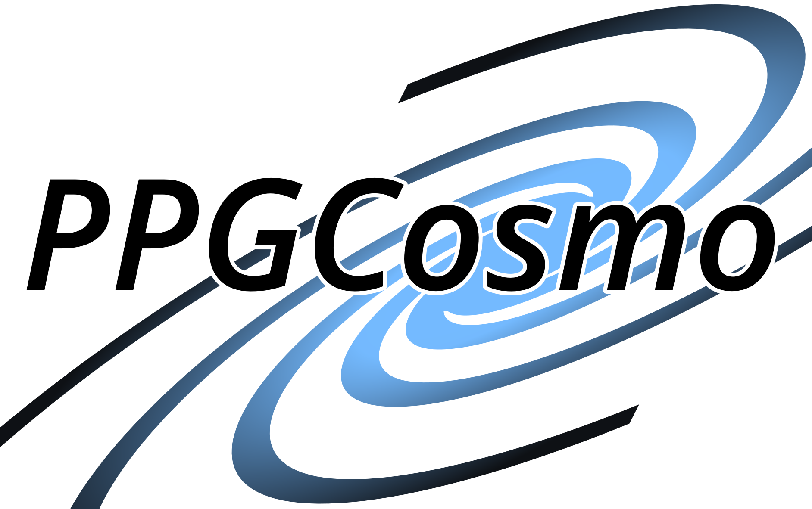

<p align="center">
  <picture>
    <source media="(prefers-color-scheme: dark)" srcset="images/ppgcosmologo-large-white-transparent.png">
    
  </picture>
</p>

# PPGCosmo logo: LaTeX package and images

The official logo of **PPGCosmo**, the Graduate Program in Astrophysics, Cosmology
and Gravitation (*Programa de Pós-Graduação em Astrofísica, Cosmologia e
Gravitação*) of the Universidade Federal do Espírito Santo (UFES), Brazil.

The logo is drawn **parametrically with TikZ**: a six-armed spiral galaxy, seen
inclined, with the lettering "PPGCosmo" superimposed. Each arm is a logarithmic
spiral, and the colour follows a radial gradient from light blue at the centre
to dark at the arm tips. Because the logo is drawn by LaTeX itself, it is vector
quality at any size and can be inserted directly into LaTeX documents and
Beamer slides.

Ready-to-use **PNG and JPG images** are also provided in [`images/`](images/).

## Contents

| File | Description |
| --- | --- |
| `ppgcosmologo.sty` | LaTeX package that provides `\ppgcosmologo` |
| `make-images.sh` | Script that renders every variant as PNG/JPG |
| `images/` | Pre-rendered images of all variants (600 dpi) |

## Using the logo in LaTeX

Copy `ppgcosmologo.sty` next to your `.tex` file (or anywhere in your TeX path) and:

```latex
\usepackage{ppgcosmologo}
...
\ppgcosmologo                                          % large logo, black on white, 3 cm high
\ppgcosmologo[height=5cm, fontcolor=white, background=black]
\ppgcosmologo[version=short, height=1cm, background=none]
```

### Options

| Option | Values | Default |
| --- | --- | --- |
| `version` | `large` (galaxy + lettering) or `short` (horizontal band cropped around the lettering) | `large` |
| `fontcolor` | `black` or `white` | `black` |
| `background` | `white`, `black` or `none` (transparent) | `white` |
| `height` | any LaTeX length | `3cm` (large), `1cm` (short) |
| `outline width` | number, in units of the arm-tip radius | automatic |
| `font` | font-selection commands | Open Sans SemiBold Italic |

`outline width` and `font` exist only as technical fallbacks. The official logo
uses their defaults (see [Usage terms](#usage-terms)).

### Requirements

- **Engine:** pdfLaTeX or LuaLaTeX. XeLaTeX also works, but without the thin
  outline of the lettering.
- **Packages:** `tikz`, `pdfrender`, `iftex` and `opensans` (all in TeX Live).
  Without `opensans`, the package falls back to Helvetica / TeX Gyre Heros
  and prints a warning. That output is not the official logo.

## Images

[`images/`](images/) has 12 files, named
`ppgcosmologo-<version>-<fontcolor>-<background>.<ext>`:

| | Black lettering | White lettering |
| --- | --- | --- |
| **Large** | `on-white` (PNG, JPG), `transparent` (PNG) | `on-black` (PNG, JPG), `transparent` (PNG) |
| **Short** | `on-white` (PNG, JPG), `transparent` (PNG) | `on-black` (PNG, JPG), `transparent` (PNG) |

Use the transparent PNGs for coloured backgrounds: black lettering on light
backgrounds, white lettering on dark ones.

### Regenerating the images

```bash
./make-images.sh            # 600 dpi, into images/
./make-images.sh 1200 out/  # custom resolution and output folder
```

Needs `pdflatex` (TeX Live, with `opensans`) and `pdftocairo` (from poppler).

## License and usage terms

This repository uses **two different licenses**. See [`LICENSE`](LICENSE) for the
full text.

- **Code** (`ppgcosmologo.sty`, `make-images.sh`):
  [MIT License](LICENSE). You may reuse and adapt the code freely.
- **The logo itself** (the design, the files in `images/` and any
  image the code produces): **not openly licensed**. The MIT License covers the
  code, not the logo it draws.

### Usage terms

In short (the binding text is in [`LICENSE`](LICENSE), Part 2):

- ✅ **Free to use, unmodified, to refer to PPGCosmo:** theses, dissertations,
  papers, talks, posters, slides, websites, news and event materials.
- ✅ Use only the official variants, scaled proportionally.
- ❌ No stretching, recolouring, cropping, rearranging or adding elements.
- ❌ Commercial use, use implying endorsement by PPGCosmo/UFES, and modified or
  derived versions need prior written permission from the PPGCosmo coordination
  (pos.cosmo@ufes.br).

## Credits

Logo designed by Davi C. Rodrigues. The parametric TikZ code was developed with
the assistance of Claude (Anthropic).
